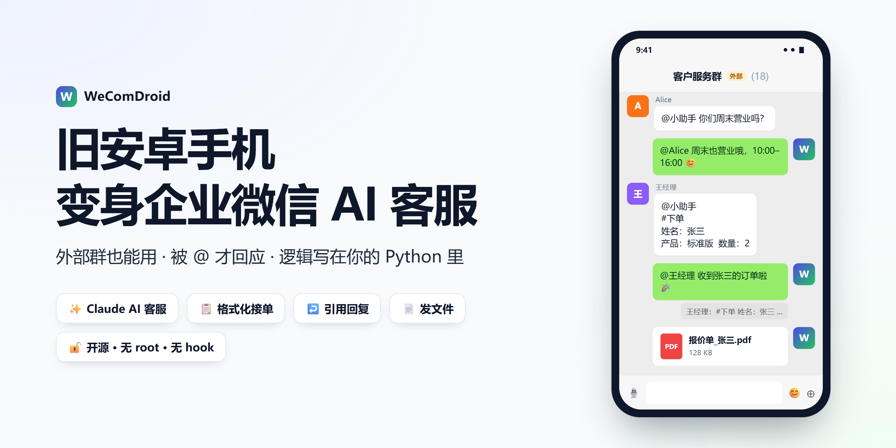
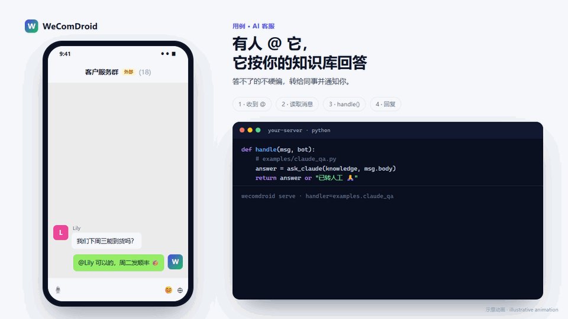
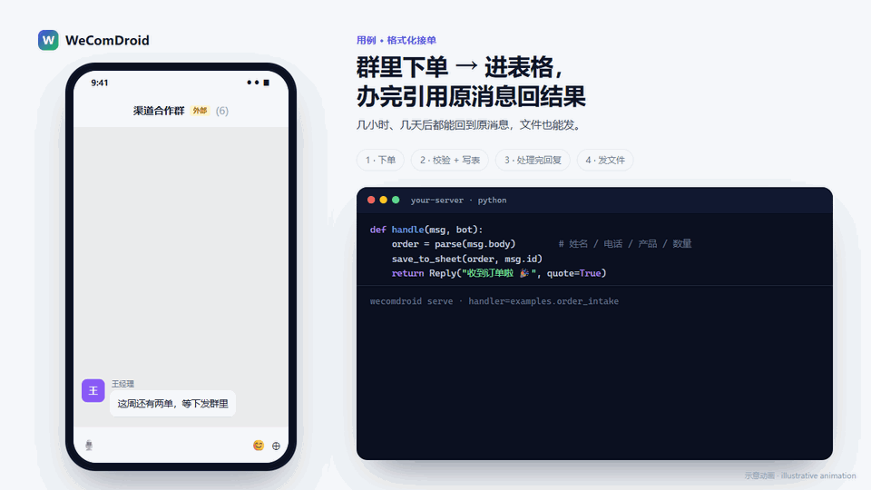
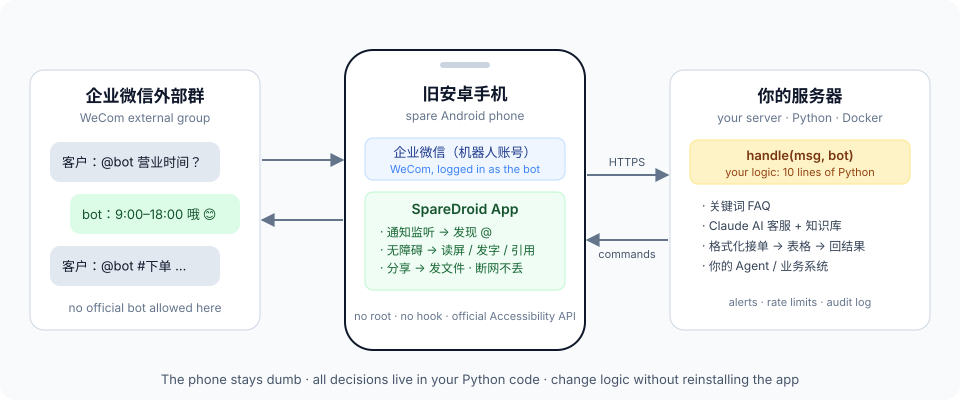
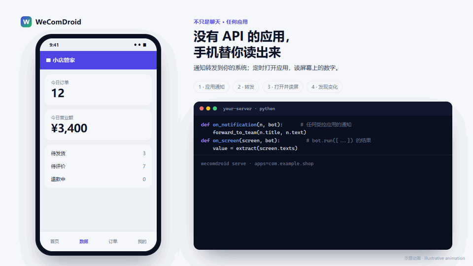

<div align="center">

# WeComDroid

**Turn a spare Android phone into an API for apps that have none**

It listens to an app's notifications, reads its screen, and taps and types for you, only in the apps you
allow-list. What to do with what it sees is a few lines of Python on your own server.
First and most polished use case: **AI customer-service / order-taking bots in WeCom (企业微信) external groups.**

WeCom's official bots can't join external groups (groups with customers outside your company).
WeComDroid lets an old Android phone sit in the group for you: when someone @-mentions it,
it reads the message, asks your code what to say, and sends the reply.

[中文](README.md) · [Quick start](#quick-start) · [Write your own logic](#write-your-own-logic)

</div>



## What it does

**AI customer service**: answers from your knowledge file, hands off to a human when unsure



**Order intake**: order in the group → validated → saved; quote-reply the result when done, send files back



<sub>Illustrative animations (simplified UI, not WeCom screenshots). Real screen recordings coming.</sub>



<details>
<summary>As text</summary>

```text
Customer  @bot what are your opening hours?
Bot       @Customer Weekdays 9:00–18:00 😊                      ← Claude answers from your knowledge file

Customer  @bot
          #order  name: Zhang San  phone: 138…  product: Standard  qty: 2
Bot       [quoting ↑] @Customer Got Zhang San's order 🎉        ← row added to your sheet
          …two hours later…
Bot       [quoting ↑] @Customer Done: https://…/invoice         ← your system finished; reply lands on the original
Bot       [📄 quote_zhangsan.pdf]                                ← files too, even days later
```

</details>

| | |
|---|---|
| **Works in external groups** | It is just a group member, so none of the official-bot restrictions apply |
| **Only answers when @-mentioned** | Normal group chatter is left alone |
| **Quote replies** | Long-press → Quote, so answers stay attached to the right message |
| **Sends files** | Through WeCom's share sheet: works by chat name, days later |
| **Logic lives on your server** | The phone only reads and sends; change behaviour without reinstalling |
| **Doesn't lose messages** | Phone-side outbox survives network loss; server deduplicates |
| **Tells you when it breaks** | Phone offline, reply not sent, customer needs a human → your internal group |

**Built on Android's official Accessibility API**: no root, no hooking, WeCom is not modified.
**Deliberately not included:** mass messaging, auto-adding contacts, auto-creating groups. Those are
spam tools and the main reason accounts get banned. WeComDroid answers when it is asked, nothing more.

## Quick start

You need a spare Android phone (8.0+, not HarmonyOS), a **dedicated** WeCom member account for the bot,
and a server that runs Docker.

```bash
git clone https://github.com/Tonieeie/wecomdroid && cd wecomdroid
cp .env.example .env        # set WECOMDROID_TOKEN, BOT_NAME, CHATS, DOMAIN
docker compose up -d        # includes Caddy with automatic HTTPS
docker compose exec wecomdroid wecomdroid config   # prints one line for the phone
```

On the phone: install WeCom and log in as the bot; install the APK from
[Releases](https://github.com/Tonieeie/wecomdroid/releases); grant **notification access**,
**accessibility**, and **no battery restrictions**; copy the config line and tap
「从剪贴板导入配置」 (import from clipboard). Details: [docs/phone-setup.md](docs/phone-setup.md).

Then say `@bot hello` in your test group.

## Ready-made handlers

| Set `WECOMDROID_HANDLER=` | |
|---|---|
| `examples.echo:handle` | Echo, to test the loop |
| `examples.keyword_faq:handle` | FAQ from a JSON file. No AI, no cost |
| `examples.claude_qa:handle` | AI customer service with Claude, grounded in your knowledge file; hands off to a human when unsure |
| `examples.order_intake:handle` | Formatted orders → validated → CSV → quote-reply the result later |

## Write your own logic

```python
from wecomdroid import Message, Reply

def handle(msg: Message, bot) -> str | Reply | None:
    if "price" in msg.body:
        return "Prices: https://example.com/pricing"
    if msg.body.startswith("#ticket"):
        return Reply(f"Ticket {create_ticket(msg.body)} created", quote=True)
    return None   # stay quiet
```

Later, from anywhere: `bot.reply(msg_id, text, quote=True)`, `bot.send_file(chat, path, caption=...)`,
`bot.alert(text)` - or the CLI: `wecomdroid reply <id> "..." --quote`.

## Beyond chat (0.2.0)

```python
def on_notification(n, bot): ...   # any notification from an allow-listed app
def on_tick(bot):                  # every ~30 s
    bot.run([{"do": "launch", "package": "com.example.shop"}, {"do": "tap", "text": "Stats"},
             {"do": "read"}, {"do": "home"}], tag="sales")
def on_screen(screen, bot): ...    # screen.texts = everything that was on screen
```



Examples: `examples.notify_forward` (notifications → webhook), `examples.screen_watch` (read a number
on a schedule, alert on change). Set `WECOMDROID_APPS` to the package names the phone may touch;
everything else is invisible to it. The generic steps are new and not yet verified on a real device;
the WeCom chat flow is. The Chinese README has the full requirements and setup tables.

## Risks

This is unofficial automation; WeCom may restrict the account. Use a dedicated account, keep the default
rate limits, start with one or two groups. The phone must stay plugged in with the screen on. See [docs/faq.md](docs/faq.md).

## License

[MIT](LICENSE). WeCom is a trademark of Tencent; this project is not affiliated with Tencent.
