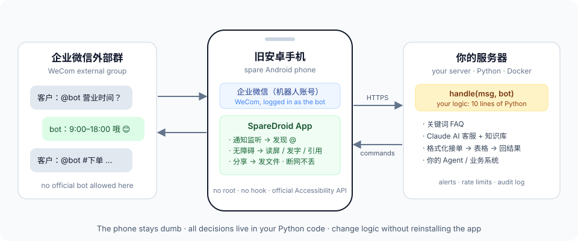

<div align="center">

# WeComDroid

**把一台旧安卓手机，变成企业微信外部群里的 AI 客服 / 接单机器人**

企业微信官方机器人进不了外部群。WeComDroid 让一台闲置安卓手机替你「坐」在群里：
有人 @ 它，它就读消息、交给你的代码决定怎么回、再替你发出去。

[English](README.en.md) · [5 分钟上手](#5-分钟上手) · [写你自己的逻辑](#写你自己的逻辑) · [常见问题](docs/faq.md)


</div>



## 它能做什么

```text
客户  @小助手 你们几点上班？
小助手 @客户 工作日 9:00–18:00 哦 😊                         ← AI 按你的知识库回答

客户  @小助手
      #下单
      姓名：张三  电话：138…  产品：标准版  数量：2
小助手 「引用↑」@客户 收到张三的订单啦 🎉 正在处理～         ← 写进表格
      ……两小时后……
小助手 「引用↑」@客户 张三的订单已完成：https://…/invoice     ← 你的系统处理完，自动回原消息
小助手 [📄 报价单_张三.pdf]                                    ← 几天后也能把文件发回原来的群
```

> 🎬 演示动图正在录制中。

| 能力 | 说明 |
|---|---|
| **外部群可用** | 官方机器人、智能机器人、自建应用都进不了外部群；它就是群里的一个普通成员 |
| **只在被 @ 时回应** | 默认只处理 @ 它的消息，不打扰群里正常聊天 |
| **引用回复** | 长按 → 引用，结果挂在原消息下面，多人下单也不会乱 |
| **发文件** | 走企业微信「分享 → 选群」，几天后也能把 PDF 发回原群 |
| **逻辑在服务器** | 手机只负责读和发；改回复逻辑不用重装 App |
| **断网不丢** | 手机先落盘、送达才删；服务器按事件去重 |
| **出事会喊人** | 手机掉线、消息没发出去、客户需要人工，都推到你的内部群 |

## 为什么做这个

市面上能在外部群自动回复的方案，要么收费、要么开源版停更多年、要么是 hook / 注入的高风险外挂。
WeComDroid 走的是**安卓官方无障碍服务**：不 root、不 hook、不改企业微信，代码全部开源可审计。

**它刻意不做的事：** 群发、自动加好友、自动拉群、批量私信。这些功能是拿来发广告的，
也是封号的主要原因。WeComDroid 只做「被叫到才回应」的客服和接单 —— 这是它的定位，也是它能长期用下去的原因。

## 5 分钟上手

你需要：一台**闲置安卓手机**（Android 8.0+，非鸿蒙）、一个**专用的企业微信员工账号**（别用自己的号）、一台能跑 Docker 的服务器。

### 1. 服务器

```bash
git clone https://github.com/Tonieeie/wecomdroid && cd wecomdroid
cp .env.example .env          # 填 WECOMDROID_TOKEN、BOT_NAME、CHATS、DOMAIN
docker compose up -d          # 自带 Caddy，自动申请 HTTPS 证书
docker compose exec wecomdroid wecomdroid config   # 打印一行配置，下一步要用
```

没有 Docker：`pip install ./server && wecomdroid serve`（自己配反向代理和 HTTPS）。

### 2. 手机

1. 安装企业微信，登录机器人账号，把它拉进一个测试群。
2. 从 [Releases](https://github.com/Tonieeie/wecomdroid/releases) 下载 APK 安装。
3. 打开 WeComDroid，依次开启：**通知使用权**、**无障碍服务**、**关闭省电限制**。
4. 把上一步打印的那行配置发到手机上复制，点 **「从剪贴板导入配置」**。

详细步骤（屏幕常亮、各品牌后台保活）见 [docs/phone-setup.md](docs/phone-setup.md)。

### 3. 试一下

在测试群里发 `@机器人 你好`，几秒后它会回 `@你 收到：你好`（默认的 echo 示例）。
跑通后，把 `.env` 里的 `WECOMDROID_HANDLER` 换成你想要的用例。

## 现成的用例

| 用例 | 设置 | 说明 |
|---|---|---|
| 回声测试 | `examples.echo:handle` | 检查整条链路通不通 |
| 关键词 FAQ | `examples.keyword_faq:handle` | 改 [faq.example.json](examples/faq.example.json) 就行，零成本、完全可控 |
| **AI 客服** | `examples.claude_qa:handle` | Claude 按你的[知识库文件](examples/knowledge.example.md)回答；答不了就转人工并通知你 |
| **格式化接单** | `examples.order_intake:handle` | 模板下单 → 校验 → 写表格 → 处理完引用原消息回结果 |

## 写你自己的逻辑

整个机器人的「大脑」就是一个函数：

```python
# my_handler.py
from wecomdroid import Message, Reply

def handle(msg: Message, bot) -> str | Reply | None:
    if "价格" in msg.body:
        return "价格表在这里：https://example.com/pricing"   # 回一句话
    if msg.body.startswith("#工单"):
        ticket = create_ticket(msg.body)                       # 调你自己的系统
        return Reply(f"已建工单 {ticket}", quote=True)          # 引用原消息回复
    return None                                                # 不回
```

```bash
WECOMDROID_HANDLER=my_handler:handle
```

| 你拿到的 | |
|---|---|
| `msg.chat` / `msg.sender` | 哪个群、谁说的 |
| `msg.body` | 去掉开头 @ 之后的正文 |
| `msg.mention_first` | 是不是以 @机器人 开头 |
| `msg.id` | 存下来，以后可以引用这条消息回复 |

| 你能做的 | |
|---|---|
| `return "文字"` | 回一句话（默认带上 `@发送人`） |
| `return Reply(text, quote=True)` | 引用原消息回复 |
| `bot.reply(msg_id, text, quote=True)` | **以后**再回（比如订单处理完） |
| `bot.send_file(chat, path, caption=...)` | 把文件发到群里 |
| `bot.alert(text)` | 通知你的团队 |

命令行也能做这些：`wecomdroid messages`、`wecomdroid reply <id> "…" --quote`、`wecomdroid send-file <群名> <文件>`。

## 它是怎么工作的

1. 企业微信来消息时会弹系统通知。App 用**通知监听**拿到它，看出有人 @ 了机器人，交给服务器。
2. 通知里的文字会被截断，所以服务器让手机**打开那个群、读出整屏文字**，找出触发的那一条（只认那一条，屏幕上的历史消息一概不管）。
3. 你的 `handle()` 决定回什么。
4. 服务器把回复排成一条**指令**；手机来取，用**无障碍服务**填字、点发送，确认输入框清空才算发成功。

设计原则：**手机越笨越好**。企业微信一改版，只要手机还能读字和发字，就只改服务器。
手机认不出界面时一律停手，绝不猜着点 —— 发错群比不发严重得多。

协议细节见 [docs/protocol.md](docs/protocol.md)。

## 风险与边界（请读一下）

- 这是**非官方自动化**，企业微信可能因此限制账号。请用专用账号、保持默认的频率限制、先在一两个群试。
- 不承诺「不封号」。我们能做的是：不 hook、不注入、不做群发，让行为尽量像真人。
- 手机要一直亮屏插电（回复时需要操作界面；只收消息不需要）。
- 只在 App 启动后、群里来过消息的情况下能「直接回复」该群；发文件不受此限制。

更多见 [docs/faq.md](docs/faq.md)。

## 企业微信改版了怎么办

App 有**侦察模式**：打开后，企业微信每换一个界面就把控件结构传到服务器的 `data/dumps/`。
遇到不兼容的新版本，开侦察模式走一遍，把导出的 JSON 附在 issue 里，就能定位改哪里。
见 [docs/adapting.md](docs/adapting.md)。

## 路线图

- [ ] 演示视频和动图
- [ ] 界面定位规则改成服务器下发的配置，适配新版本不用重编译 App
- [ ] MCP 服务：让 Claude / Cursor 等 AI 工具直接读群消息、往群里回复
- [ ] Claude Code skill：一步步带你把手机和服务器配好
- [ ] 回复前自动点亮屏幕

欢迎 issue 和 PR，尤其是不同手机品牌、不同企业微信版本的兼容反馈。

## 来历

这个项目来自一个真实需求：渠道在企业微信外部群里发保险订单，原来要人工抄进表格。
现在机器人认出订单、写进出单队列，出单后引用原消息回支付链接，付款后再把保单 PDF 发回群里。
`examples/order_intake.py` 就是那套流程去掉业务细节后的样子。

## License

[MIT](LICENSE)。企业微信是腾讯的商标；本项目与腾讯无关。
